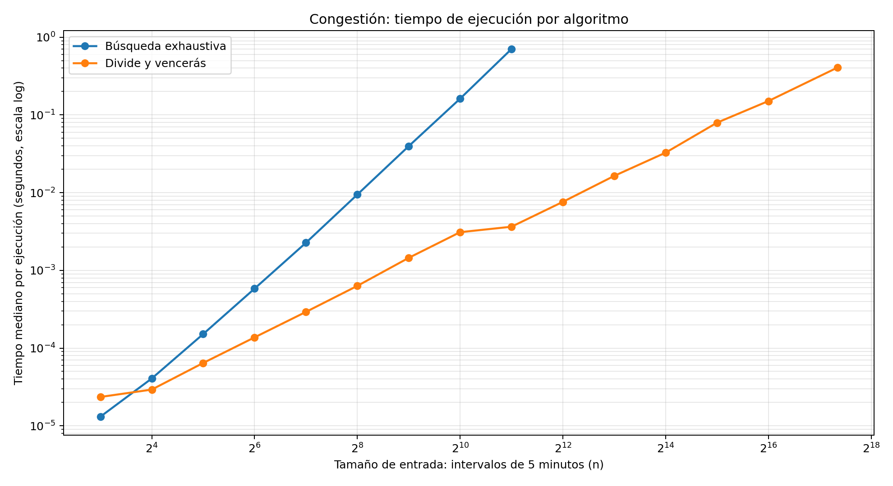
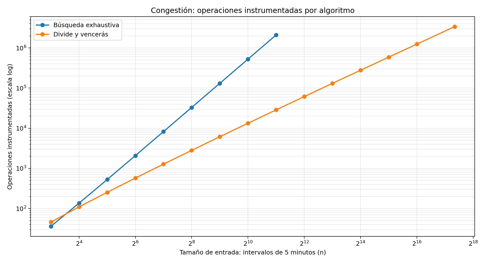

# Proyecto Final — Análisis de Algoritmos

**Institución:** Instituto Tecnológico Metropolitano (ITM)  
**Asignatura:** Análisis de Algoritmos · **Periodo:** 2026-2  
**Grupo:** 10 — Asíncrono  
**Caso asignado:** Caso 1 — Conciliación nocturna del recaudo del Sistema Integrado de Transporte del Valle Metropolitano (SITVM)

**Integrantes:**

- Juan Felipe Cadavid Zabala
- Paula Andrea Calderón Quintero
- Juan David Velásquez Murillo
- Jhon Fernando Sánchez Álvarez

**Fecha de entrega:** 23 de noviembre de 2026.  
**Operaciones seleccionadas:** Operación 3 — Detección de franjas de congestión; Operación 4 — Liquidación del tope tarifario.  
**Repositorio:** [Proyecto-Final-Analisis-Algoritmos](https://github.com/jfcadavid/Proyecto-Final-Analisis-Algoritmos).

En este proyecto estudiamos dos operaciones del SITVM: **liquidación del tope tarifario** y **detección de franjas de congestión**. Para cada una analizamos el problema, diseñamos alternativas algorítmicas, implementamos las soluciones en Python y verificamos sus resultados. También medimos el rendimiento con datos sintéticos y estimamos el consumo energético para recomendar las estrategias más adecuadas. Las mediciones se realizaron en un computador de pruebas, no en el servidor real del SITVM.

## Cómo ejecutar el proyecto

### Requisitos y preparación

Necesitamos **Python 3.10 o posterior**, Git y una terminal, como PowerShell o la de Visual Studio Code. Para generar las gráficas usamos `matplotlib`, incluida en `requirements.txt`. No es necesaria una interfaz gráfica, una base de datos ni un servicio web.

Si todavía no tenemos el repositorio, lo descargamos y entramos en su carpeta:

```powershell
git clone https://github.com/jfcadavid/Proyecto-Final-Analisis-Algoritmos.git
cd Proyecto-Final-Analisis-Algoritmos
```

Si ya lo tenemos en el computador, abrimos la carpeta del proyecto en Visual Studio Code y, después de guardar los cambios locales, podemos actualizarla con `git pull origin main`. Desde la **raíz del repositorio** instalamos la dependencia:

```powershell
python -m pip install -r requirements.txt
```

En Windows también se puede utilizar `py` cuando `python` no esté disponible.

### Ejecutar la operación 4 — Tope tarifario

Primero comprobamos que los algoritmos entreguen los resultados esperados:

```powershell
python src/tope_tarifario/pruebas.py
```

Después ejecutamos sus experimentos:

```powershell
python src/tope_tarifario/medicion.py
```

Este último comando genera `resultados.csv`, `tiempo_vs_n.png` y `operaciones_vs_n.png` dentro de `graficas/tope_tarifario/`. Los datos y las gráficas describen la ejecución en el computador donde se lance el programa.

### Ejecutar la operación 3 — Franjas de congestión

Primero ejecutamos sus pruebas automatizadas:

```powershell
python src/congestion/pruebas.py
```

Si todo está correcto, el programa confirma los **16 casos fijos**, las **300 instancias aleatorias reproducibles** y las comprobaciones adicionales del generador y las entradas inválidas. Para producir las mediciones:

```powershell
python src/congestion/medicion.py
```

Los resultados se guardan en `graficas/congestion/`:

- `resultados.csv`: tiempos, operaciones y tramos encontrados.
- `tiempo_vs_n.png` y `operaciones_vs_n.png`: gráficas comparativas.
- `resumen_mediciones.md`: resumen automático de la ejecución para facilitar la elaboración del informe.

Los tiempos cambian según el equipo. Para este informe utilizamos los resultados de los archivos CSV que acompañan las gráficas; si volvemos a ejecutar los experimentos, debemos revisar el resumen y actualizar las cifras correspondientes. La búsqueda exhaustiva de congestión se detiene en tamaños pequeños; **no** se ejecuta con 166.000 intervalos porque su costo es muy alto.

### Organización de archivos

```text
Proyecto-Final-Analisis-Algoritmos/
├── README.md
├── requirements.txt
├── src/
│   ├── tope_tarifario/
│   │   ├── estrategia.py
│   │   ├── exhaustivo.py
│   │   ├── regla_actual.py
│   │   ├── datos.py
│   │   ├── pruebas.py
│   │   └── medicion.py
│   └── congestion/
│       ├── exhaustivo.py
│       ├── divide_venceras.py
│       ├── datos.py
│       ├── pruebas.py
│       └── medicion.py
└── graficas/
    ├── tope_tarifario/
    │   ├── resultados.csv
    │   ├── tiempo_vs_n.png
    │   └── operaciones_vs_n.png
    └── congestion/
        ├── resultados.csv
        ├── tiempo_vs_n.png
        ├── operaciones_vs_n.png
        └── resumen_mediciones.md
```

Los archivos que comparten nombre no se sustituyen: `src/tope_tarifario/exhaustivo.py` resuelve combinaciones de pases, mientras que `src/congestion/exhaustivo.py` busca tramos consecutivos de mayor suma.

---

## 1. Análisis del problema

### 1.1. Contexto y operaciones críticas del SITVM

El SITVM opera metro, dos líneas de cable y buses alimentadores en un área metropolitana cercana a cuatro millones de habitantes. Los usuarios validan sus viajes mediante tarjetas sin contacto, y un proceso nocturno organiza la información para Recaudo, Atención al Usuario y Planeación de la Operación.

El caso describe cuatro operaciones críticas: **(1)** deduplicar validaciones, **(2)** ordenar por tarjeta y hora, **(3)** detectar franjas de congestión y **(4)** liquidar el tope tarifario. El proceso actual tarda **más de ocho horas**. Las operaciones 1 y 2 deben terminar dentro de la ventana de **00:00 a 04:00**, y la operación 4 comparte esa ventana durante el cierre mensual. Para la operación 3 el enunciado no fija una ventana individual de cuatro horas.

El cliente informa alrededor de **1.400.000 validaciones diarias**, entre **4 % y 9 % de registros repetidos**, **950.000 tarjetas usadas al mes**, **80 estaciones** y un único servidor de aproximadamente **500 W** bajo carga sostenida, sin procesamiento paralelo. Estas cifras son contexto del caso; no son datos reales que hayamos procesado.

Seleccionamos las operaciones 4 y 3 porque ambas necesitan resultados exactos y permiten comparar métodos con comportamientos computacionales diferentes. La energía de referencia del proceso completo, si el servidor trabaja más de ocho horas a 0,5 kW constantes, supera **4 kWh por ejecución nocturna**. No podemos atribuir ese consumo solamente a las dos operaciones seleccionadas.

### 1.2. Operación 4 — Liquidación del tope tarifario

Al cierre de cada mes, ninguna persona con tarjeta personalizada debe pagar más que la combinación de productos más barata que cubra todos sus viajes. Si el sistema cobró una cantidad superior, debe devolver la diferencia exacta como saldo de la tarjeta. La estrategia actual descrita en el caso explora combinaciones de pases; cuando esta búsqueda tarda demasiado, utiliza una regla simplificada que puede cobrar de más.

**Entradas:** `viajes_por_dia`, lista ordenada de enteros no negativos que indica cuántos viajes hubo en cada día, y `cobrado`, valor total descontado, expresado en pesos colombianos. **Salidas:** costo mínimo exacto y devolución `max(0, cobrado - costo_minimo)`. Los viajes de la lista se suponen previamente depurados y no debemos modificarla.

| Producto del perfil general | Precio (COP) | Cobertura |
|---|---:|---|
| Pasaje sencillo | $3.900 | Un viaje |
| Pase diario | $9.500 | Viajes ilimitados durante un día |
| Pase semanal | $36.000 | Siete días consecutivos |
| Pase mensual | $135.000 | Treinta días consecutivos |

El caso menciona tarifas diferenciales, pero no suministra sus valores, por lo que nuestros cálculos utilizan exclusivamente el perfil general. Suponemos que los pases pueden empezar en cualquier día del periodo; si su cobertura termina después del último día evaluado, los días sobrantes no generan costo adicional en esta liquidación. Si un día no tiene viajes, podemos avanzar sin comprar nada. Trabajamos con cantidades enteras en COP y conservamos la lista original.

### 1.3. Operación 3 — Detección de las franjas de congestión

Como segunda operación escogimos la **detección de franjas de congestión**. Planeación necesita identificar, para cada estación, el tramo de intervalos consecutivos de cinco minutos cuya **suma de saldos netos de pasajeros sea la mayor**. Esta información ayuda a determinar cuándo y dónde sería conveniente reforzar la frecuencia de los trenes.

En cada intervalo se calcula:

```text
Saldo neto = pasajeros que ingresaron - pasajeros evacuados por los trenes
```

Un valor positivo indica que ingresaron más pasajeros de los que fueron evacuados; un valor negativo, que salieron más de los que entraron. La suma de un tramo representa su **cambio neto acumulado**, no la ocupación total de la plataforma.

El programa actual evalúa todos los tramos posibles. Según el caso, tarda varios minutos por estación con un mes de información y no termina en un tiempo útil para el histórico de dos años, de aproximadamente **166.000 intervalos por estación**. El enunciado no muestra el código interno; por eso calculamos la complejidad de la **implementación exhaustiva que construimos**, sin afirmar que conocemos exactamente la del programa real.

**Entrada:** una lista cronológica de enteros `saldos` para una estación. El tamaño `n` es el número de intervalos de cinco minutos. Por ejemplo:

```python
saldos = [3, -2, 5, -1, 4, -6, 2, -1]
```

En el ejemplo `n = 8`. **Salida:** una tupla `(suma_maxima, inicio, fin)` que contiene la mayor suma y las posiciones inicial y final, ambas incluidas, usando índices desde cero.

Las restricciones y decisiones que aplicamos son:

- Encontrar el **máximo exacto**, no una aproximación, sobre un tramo **consecutivo y no vacío**.
- Considerar valores positivos, negativos y ceros. Si todos son negativos, se devuelve el intervalo menos negativo.
- Recibir listas con `n >= 1` y **no modificar la entrada**.
- Resolver una estación por llamada; para otras estaciones se repite la función.
- **Criterio de desempate del equipo:** ante sumas iguales, escoger el inicio más pequeño; si también coincide, el final más pequeño. El caso no establece una regla específica para empates, pero necesitamos una para comparar las dos soluciones.

Usamos una **lista** para conservar el orden temporal y una **tupla de tres enteros** para que los dos algoritmos entreguen el mismo formato de resultado.

---

## 2. Diseño de la solución

### 2.1. Operación 4 — Programación dinámica, búsqueda exhaustiva y regla simplificada

Escogimos **programación dinámica** como estrategia principal. La compra de un pase semanal o mensual cubre varios días y afecta las decisiones posteriores; por eso no siempre es correcto escoger la opción que parece más conveniente en el primer día.

Existe **subestructura óptima** porque, una vez escogida una compra, los días que faltan también deben cubrirse al menor costo posible. Además, hay **subproblemas repetidos** cuando diferentes combinaciones llevan al mismo día pendiente de pago. La programación dinámica calcula y guarda una vez cada resultado.

Definimos `C(t)` como el menor costo de cubrir desde el día `t` hasta el final de un periodo de `d` días, usando días numerados desde 1. Si hay viajes el día `t`:

```text
C(t) = min(
    min(3900 * viajes[t], 9500) + C(t + 1),
    36000 + C(min(t + 7, d + 1)),
    135000 + C(min(t + 30, d + 1))
)
```

La primera opción paga solamente el día actual; la segunda compra un pase semanal; la tercera, un mensual. En Python el valor del día `t` se lee como `viajes_por_dia[t - 1]`. Si no hay viajes, `C(t) = C(t + 1)`; el **caso base** es `C(d + 1) = 0`. La tabla de costos se llena del **último día al primero**, porque cada decisión usa resultados de días posteriores. Guardamos también las decisiones para recuperar una combinación óptima de productos.

Para comprobar este enfoque implementamos una **búsqueda exhaustiva**, que considera las combinaciones sin reutilizar subproblemas. Además, construimos una **regla simplificada de comparación**: calcula el menor costo diario y, desde el primer día pendiente, considera un pase mensual si el total de hasta 30 días supera $135.000; si no, considera un pase semanal para hasta siete días cuando el total supera $36.000; de lo contrario paga solo el día. Esta es **nuestra interpretación reproducible** del enunciado, no una copia ni una verificación del software real del SITVM.

#### Ejemplo de ocho días y contraejemplo de la regla simplificada

Tomamos una lista ficticia:

```python
viajes_por_dia = [1, 3, 3, 3, 3, 0, 0, 3]
```

| Día | 1 | 2 | 3 | 4 | 5 | 6 | 7 | 8 |
|---|---:|---:|---:|---:|---:|---:|---:|---:|
| Viajes | 1 | 3 | 3 | 3 | 3 | 0 | 0 | 3 |

Con un viaje conviene pagar $3.900; con tres viajes el pase diario cuesta $9.500 frente a $11.700 en pasajes sencillos. Calculamos `C(9) = 0` y avanzamos hacia atrás:

| Día `t` | Viajes | Pagar hoy y continuar | Semanal y continuar | Mensual y continuar | `C(t)` |
|---:|---:|---:|---:|---:|---:|
| 9 | — | — | — | — | **$0** |
| 8 | 3 | $9.500 | $36.000 | $135.000 | **$9.500** |
| 7 | 0 | Sin compra | — | — | **$9.500** |
| 6 | 0 | Sin compra | — | — | **$9.500** |
| 5 | 3 | $9.500 + $9.500 = $19.000 | $36.000 | $135.000 | **$19.000** |
| 4 | 3 | $9.500 + $19.000 = $28.500 | $36.000 | $135.000 | **$28.500** |
| 3 | 3 | $9.500 + $28.500 = $38.000 | $36.000 | $135.000 | **$36.000** |
| 2 | 3 | $9.500 + $36.000 = $45.500 | $36.000 | $135.000 | **$36.000** |
| 1 | 1 | $3.900 + $36.000 = $39.900 | $36.000 + $9.500 = $45.500 | $135.000 | **$39.900** |

La mejor combinación es **un pasaje sencillo el día 1 ($3.900)** y **un pase semanal desde el día 2 hasta el 8 ($36.000)**. El costo mínimo es **$39.900**. Si se hubieran cobrado individualmente los 16 viajes por $3.900, el cobro hipotético sería $62.400 y la devolución correcta sería **$22.500**.

La regla simplificada compra el semanal desde el **día 1** porque los costos diarios de los días 1 a 7 suman $41.900, mayor que $36.000; debe pagar además $9.500 por los viajes del día 8. Obtiene **$45.500**, es decir, **$5.600 más** que el óptimo. Es un contraejemplo de nuestra regla interpretada y no una afirmación sobre el código real del SITVM.

Una regla voraz de escoger el menor costo de cada día sería suficiente **si no existieran pases que cubrieran varios días**. Con los pases semanales y mensuales, las decisiones interactúan y necesitamos considerar el periodo completo.

### 2.2. Operación 3 — Búsqueda exhaustiva y divide y vencerás

Diseñamos dos soluciones exactas para `saldos`, con la misma salida `(suma_maxima, inicio, fin)`. La exhaustiva sirve como referencia y **divide y vencerás** es la propuesta de mejora. Ambas respetan los empates y no cambian la lista original.

Primero acordamos cómo comparar dos candidatos:

```text
FUNCIÓN es_mejor(candidata, actual):
    SI candidata.suma > actual.suma: RETORNAR VERDADERO
    SI candidata.suma < actual.suma: RETORNAR FALSO
    SI candidata.inicio < actual.inicio: RETORNAR VERDADERO
    SI candidata.inicio > actual.inicio: RETORNAR FALSO
    RETORNAR candidata.fin < actual.fin
```

#### Búsqueda exhaustiva

Recorremos cada posible posición inicial y sumamos progresivamente los valores siguientes. La suma acumulada evita recalcular desde cero el mismo prefijo de cada tramo. Al revisar todos los tramos no vacíos, encontramos el máximo exacto.

```text
FUNCIÓN tramo_maximo_exhaustivo(saldos):
    n = longitud(saldos)        // n >= 1
    mejor = (saldos[0], 0, 0)

    PARA inicio DESDE 0 HASTA n - 1:
        suma = 0
        PARA fin DESDE inicio HASTA n - 1:
            suma = suma + saldos[fin]
            candidata = (suma, inicio, fin)
            SI es_mejor(candidata, mejor):
                mejor = candidata

    RETORNAR mejor
```

Evaluamos exactamente `n(n + 1) / 2` tramos. Esperamos **tiempo Θ(n²)** y **espacio auxiliar Θ(1)**, sin contar la lista de entrada.

#### Divide y vencerás

Dividimos la serie en dos mitades. El tramo máximo solo puede estar **completamente a la izquierda**, **completamente a la derecha** o **cruzar el centro**. Resolvemos recursivamente las primeras dos posibilidades y calculamos la tercera buscando el mejor sufijo izquierdo y el mejor prefijo derecho. Después elegimos la opción ganadora con el criterio de desempate.

```text
FUNCIÓN tramo_maximo_divide_venceras(saldos):
    RETORNAR resolver(saldos, 0, longitud(saldos) - 1)

FUNCIÓN resolver(saldos, inicio, fin):
    SI inicio == fin:
        RETORNAR (saldos[inicio], inicio, fin)

    centro = (inicio + fin) // 2
    izquierda = resolver(saldos, inicio, centro)
    derecha = resolver(saldos, centro + 1, fin)
    cruce = mejor_cruce(saldos, inicio, centro, fin)

    mejor = izquierda
    SI es_mejor(derecha, mejor): mejor = derecha
    SI es_mejor(cruce, mejor): mejor = cruce
    RETORNAR mejor
```

Para calcular el mejor cruce, partimos de sumas `-infinito`, de modo que funcionen también las listas con valores negativos:

```text
FUNCIÓN mejor_cruce(saldos, inicio, centro, fin):
    suma = 0
    mejor_izquierda = -infinito
    inicio_cruce = centro

    PARA i DESDE centro HASTA inicio, RETROCEDIENDO:
        suma = suma + saldos[i]
        SI suma > mejor_izquierda O
           (suma == mejor_izquierda Y i < inicio_cruce):
            mejor_izquierda = suma
            inicio_cruce = i

    suma = 0
    mejor_derecha = -infinito
    fin_cruce = centro + 1

    PARA j DESDE centro + 1 HASTA fin:
        suma = suma + saldos[j]
        SI suma > mejor_derecha:
            mejor_derecha = suma
            fin_cruce = j

    RETORNAR (mejor_izquierda + mejor_derecha,
              inicio_cruce, fin_cruce)
```

Cuando las sumas son iguales, en la izquierda preferimos el inicio más pequeño y en la derecha conservamos el primer final que obtuvo la mejor suma. El caso base es un segmento de un solo elemento. La recurrencia `T(n) = 2T(n/2) + Θ(n)` conduce a **tiempo Θ(n log n)** y, usando índices sin copiar sublistas, **espacio auxiliar Θ(log n)** por la pila recursiva.

#### Ejemplo manual de ocho intervalos

Usamos esta lista ficticia de una estación:

```python
saldos = [3, -2, 5, -1, 4, -6, 2, -1]
```

| Intervalo | Posición en Python | Saldo neto |
|---:|---:|---:|
| 1 | 0 | +3 |
| 2 | 1 | -2 |
| 3 | 2 | +5 |
| 4 | 3 | -1 |
| 5 | 4 | +4 |
| 6 | 5 | -6 |
| 7 | 6 | +2 |
| 8 | 7 | -1 |

Para verificar la búsqueda exhaustiva, fijamos cada inicio y obtenemos su mejor final:

| Inicio | Mejor final | Mayor suma desde ese inicio |
|---:|---:|---:|
| 1 | 5 | **9** |
| 2 | 5 | 6 |
| 3 | 5 | 8 |
| 4 | 5 | 3 |
| 5 | 5 | 4 |
| 6 | 7 | -4 |
| 7 | 7 | 2 |
| 8 | 8 | -1 |

Con divide y vencerás dividimos entre las posiciones 3 y 4. El mejor tramo de la izquierda es `3 - 2 + 5 = 6` (posiciones 0–2); el mejor de la derecha es `4` (posición 4). El mejor cruce usa el sufijo izquierdo `3 - 2 + 5 - 1 = 5` y el prefijo derecho `4`: suma **9** entre las posiciones **0 y 4**. Como `9 > 6` y `9 > 4`, ambos algoritmos devuelven **`(9, 0, 4)`**.

Ese tramo corresponde a **cinco intervalos de cinco minutos (25 minutos)**. El valor 9 representa la suma neta de esos intervalos, no necesariamente nueve personas presentes en toda la plataforma.

---

## 3. Implementación

### 3.1. Tecnologías y decisiones de implementación

Implementamos las estrategias en **Python**, con funciones de responsabilidad específica, anotaciones de tipos y documentación. Utilizamos `random` para los datos sintéticos, `time.perf_counter()` para las mediciones, `csv` para guardar resultados y `matplotlib` para las gráficas. No utilizamos bases de datos, interfaces ni procesamiento paralelo, tal como permite el enunciado.

El código de las dos operaciones está separado para evitar confundir datos de viajes diarios con saldos de pasajeros por intervalos. Las listas originales no se modifican; las funciones devuelven resultados nuevos y, para medir, utilizamos las mismas entradas por tamaño en los algoritmos que se comparan.

### 3.2. Archivos de la operación 4

| Archivo | Responsabilidad |
|---|---|
| [`estrategia.py`](src/tope_tarifario/estrategia.py) | Programación dinámica, costo mínimo, compras óptimas y devolución exacta. |
| [`exhaustivo.py`](src/tope_tarifario/exhaustivo.py) | Buscar todas las combinaciones para verificar casos pequeños. |
| [`regla_actual.py`](src/tope_tarifario/regla_actual.py) | Simular la regla simplificada interpretada. |
| [`datos.py`](src/tope_tarifario/datos.py) | Generar cantidades de viajes por día con semilla fija. |
| [`pruebas.py`](src/tope_tarifario/pruebas.py) | Verificar costos, devoluciones, meses de 30–31 días y 30 casos aleatorios. |
| [`medicion.py`](src/tope_tarifario/medicion.py) | Medir tiempos y operaciones; generar CSV y gráficas. |

La función `costo_minimo()` devuelve el costo más bajo; `liquidar_tope()` calcula la devolución sin permitir valores negativos. Para el ejemplo de ocho días, las funciones exactas devuelven **$39.900** y la regla simplificada **$45.500**.

### 3.3. Archivos de la operación 3

| Archivo | Responsabilidad |
|---|---|
| [`exhaustivo.py`](src/congestion/exhaustivo.py) | Buscar todos los tramos consecutivos y contar los examinados. |
| [`divide_venceras.py`](src/congestion/divide_venceras.py) | Resolver recursivamente las mitades y el mejor cruce. |
| [`datos.py`](src/congestion/datos.py) | Generar saldos netos sintéticos reproducibles. |
| [`pruebas.py`](src/congestion/pruebas.py) | Comprobar resultados exactos, empates, negativos, datos originales y errores de entrada. |
| [`medicion.py`](src/congestion/medicion.py) | Registrar tiempos y contadores; guardar CSV, PNG y resumen automático. |

Ambas funciones principales de congestión devuelven la tupla `(suma_maxima, inicio, fin)`. Sus contadores de operaciones se ejecutan **fuera del cronómetro**: representan trabajos definidos en cada implementación y sirven principalmente para analizar su crecimiento.

---

## 4. Evaluación del desempeño

### 4.1. Pruebas de correctitud

En la operación 4 ejecutamos casos límite, el ejemplo resuelto a mano, verificaciones de devolución y **30 instancias aleatorias** pequeñas. Comprobamos que la programación dinámica y la búsqueda exhaustiva obtienen el mismo mínimo y que el cálculo no altera los datos originales.

En la operación 3 las pruebas del equipo dieron el siguiente resultado:

```text
Pruebas correctas de la operación 3 — Congestión del SITVM
Casos fijos comprobados: 16
Instancias aleatorias reproducibles: 300
Comprobaciones adicionales: generador y entradas inválidas
Resultado: ambos algoritmos coinciden y conservan las entradas.
```

Los **16 casos definidos** incluyen valores positivos, negativos, ceros, empates, segmentos de un elemento y el ejemplo de ocho intervalos. Las **300 instancias aleatorias**, reproducibles con semilla fija, comparan las dos estrategias exactas en listas de 1 a 32 intervalos. También verificamos que los índices devueltos estén dentro de la lista, que la suma coincida con el tramo y que ninguna función modifique la entrada. En los tamaños compartidos de las mediciones, los dos algoritmos también devolvieron la misma suma máxima y los mismos límites.

Estas pruebas son evidencia sobre los casos ejecutados; no sustituyen por sí solas una demostración matemática para todas las entradas.

### 4.2. Complejidad temporal y espacial

| Operación | Estrategia | Tiempo | Espacio auxiliar | Motivo |
|---|---|---|---|---|
| Tope tarifario | Programación dinámica | **Θ(d)** | **Θ(d)** | Evalúa un número fijo de decisiones por día y guarda una tabla. |
| Tope tarifario | Exhaustiva | **Exponencial en el peor caso** | **O(d)** | Explora combinaciones recursivas sin memorizar subproblemas. |
| Tope tarifario | Regla simplificada | **Θ(d)** | **Θ(d)** | Revisa días y ventanas de 7 o 30 días, de longitud fija. |
| Congestión | Exhaustiva con suma acumulada | **Θ(n²)** | **Θ(1)** | Examina `n(n+1)/2` tramos. |
| Congestión | Divide y vencerás | **Θ(n log n)** | **Θ(log n)** | Divide en mitades y calcula el mejor cruce en tiempo lineal. |

Aquí `d` es el número de días del periodo y `n` el número de intervalos de cinco minutos. Las complejidades describen **los algoritmos que implementamos**, no una inspección del programa interno del SITVM.

### 4.3. Metodología de medición

Para la operación 4 usamos la semilla `2026`, entradas sintéticas con viajes en todos los días y tamaños de **4, 8, 12, 16, 24, 28, 30, 31 y 32 días**, además de tamaños de escalabilidad de **64 a 16.384 días**. La búsqueda exhaustiva solo se midió hasta 32 días. Registramos el **tiempo medio de varias ejecuciones**, los contadores y los costos encontrados. Los periodos superiores a 31 días son exclusivamente pruebas de escalabilidad: no representan meses reales.

Para congestión generamos listas sintéticas con saldos entre **−50 y 50**, semilla `2026`. Medimos **los tiempos medianos** de varias repeticiones, desde **8 hasta 2.048 intervalos** con los dos algoritmos y hasta **166.000** con divide y vencerás. Generación de datos, comprobaciones y contadores quedaron fuera del intervalo cronometrado. No debemos mezclar estas medianas con los promedios del experimento de tope tarifario.

Los registros completos están disponibles en [`graficas/tope_tarifario/resultados.csv`](graficas/tope_tarifario/resultados.csv) y [`graficas/congestion/resultados.csv`](graficas/congestion/resultados.csv).

### 4.4. Resultados de la operación 4: medido frente a lo esperado

Al duplicar la entrada de **16 a 32 días** obtuvimos:

| Estrategia | Tiempo 16 días | Tiempo 32 días | Factor de tiempo | Operaciones 16 → 32 | Factor de operaciones |
|---|---:|---:|---:|---:|---:|
| Programación dinámica | 0,0271 ms | 0,0559 ms | **2,07×** | 48 → 96 | **2,00×** |
| Búsqueda exhaustiva | 0,0913 ms | 3,6968 ms | **40,49×** | 195 → 7.671 | **39,34×** |
| Regla simplificada | 0,0168 ms | 0,0187 ms | **1,11×** | 73 → 76 | **1,04×** |

La programación dinámica duplicó aproximadamente el trabajo, como esperamos de `Θ(d)`. La búsqueda exhaustiva aumentó mucho más, coherente con su crecimiento exponencial. La regla simplificada saltó varios días cubiertos por pases, por eso el cambio observado fue pequeño; **eso no significa que su complejidad sea constante**.

Las soluciones exactas coincidieron en los nueve tamaños pequeños. En cambio, la regla simplificada produjo costos superiores al mínimo en algunas entradas sintéticas:

| Días | Costo mínimo | Regla simplificada | Diferencia |
|---:|---:|---:|---:|
| 16 | $79.800 | $91.000 | **$11.200** |
| 24 | $119.700 | $135.000 | **$15.300** |
| 128 | $579.900 | $583.800 | **$3.900** |
| 256 | $1.158.900 | $1.215.000 | **$56.100** |

Los tamaños de 128 y 256 días no corresponden a meses reales. En todos los casos, la regla comparada es nuestra interpretación reproducible, no el código de producción del SITVM.

### 4.5. Resultados de la operación 3: medido frente a lo esperado

Al duplicar la entrada de **1.024 a 2.048 intervalos** encontramos:

| Algoritmo | 1.024 intervalos | 2.048 intervalos | Factor de tiempo | Operaciones 1.024 → 2.048 | Factor de operaciones |
|---|---:|---:|---:|---:|---:|
| Búsqueda exhaustiva | 161,7441 ms | 704,1544 ms | **4,35×** | 524.800 → 2.098.176 | **4,00×** |
| Divide y vencerás | 3,0982 ms | 3,6426 ms | **1,18×** | 13.310 → 28.670 | **2,15×** |

La exhaustiva examinó cuatro veces más tramos al duplicar los intervalos, como corresponde a `Θ(n²)`. Divide y vencerás registró cerca de **2,15 veces** más trabajo, coherente con `Θ(n log n)`. Su tiempo mediano solo aumentó **1,18 veces** en esta pareja; las mediciones de pocos milisegundos pueden variar por el intérprete de Python, el sistema operativo y la carga del computador. Por eso consideramos tanto el tiempo como las operaciones instrumentadas. Los contadores de los dos métodos no miden exactamente el mismo tipo de operación, así que comparamos su **crecimiento dentro de cada método**, no sus cifras absolutas como si fueran instrucciones equivalentes.

Para **166.000 intervalos**, ejecutamos divide y vencerás y medimos **0,405722 segundos por estación**. No ejecutamos exhaustiva con ese tamaño: calculamos su tiempo estimado a partir de la medición de 2.048 intervalos y la relación entre las cantidades de tramos `n(n+1)/2`.

### 4.6. Escala operativa, limitaciones de las estimaciones y energía

**Tope tarifario.** Para explorar un escenario exigente suponemos **950.000 tarjetas**, todas con viajes en **31 días**. Al tratar cada tarjeta secuencialmente, multiplicamos el tiempo medio medido por tarjeta por 950.000. Esto suma tarjetas con el mismo tamaño de entrada; **no equivale a suponer que la exhaustiva crece linealmente con el número de días**.

| Estrategia | Tiempo medido por tarjeta | Tiempo estimado para 950.000 tarjetas |
|---|---:|---:|
| Programación dinámica | 0,0511 ms | **48,56 s** |
| Regla simplificada | 0,0155 ms | **14,74 s** |
| Exhaustiva | 2,9197 ms | **2.773,74 s (46,23 min)** |

En esa simulación aislada las tres alternativas cabrían en cuatro horas, pero **no podemos afirmar que el proceso nocturno completo cumpla la ventana**: faltan operaciones 1 y 2, lectura y escritura de registros, integración y validación en el servidor real. Tampoco sabemos cuántas de las 950.000 tarjetas son personalizadas ni la distribución real de los días con viajes. Si aumentan los días activos, la búsqueda exhaustiva se vuelve rápidamente inviable por su crecimiento exponencial.

**Congestión.** Para el histórico de dos años utilizamos **166.000 intervalos por estación** y **80 estaciones**, procesadas secuencialmente. La tabla distingue lo medido de lo estimado:

| Estrategia | Tiempo por estación | Tiempo para 80 estaciones | Energía para 80 estaciones (500 W) |
|---|---:|---:|---:|
| Búsqueda exhaustiva | **4.623,97 s, estimado** | **102,75 h, estimado** | **51,3774 kWh, estimado** |
| Divide y vencerás | **0,405722 s, medido** | **32,46 s, estimado** | **0,004508 kWh, estimado** |

La exhaustiva demoraría alrededor de **4,28 días** por análisis histórico completo de las 80 estaciones en este escenario extrapolado, mientras que divide y vencerás permitiría calcularlo en segundos. Son resultados de un modelo basado en nuestro computador; no tenemos mediciones del servidor del SITVM. La operación 3 **no tiene una ventana obligatoria de cuatro horas especificada en el caso**; podemos usarla solamente como referencia comparativa.

La relación energética es:

```text
Potencia estimada = 500 W = 0,5 kW
Energía (kWh) = 0,5 kW × tiempo (horas)
```

Para **tope tarifario**, la energía del escenario de 950.000 tarjetas sería aproximadamente **0,00674 kWh** con programación dinámica, **0,00205 kWh** con la regla simplificada y **0,38524 kWh** con exhaustiva por cierre mensual. Si fueran **12 cierres al año**, resultarían aproximadamente **0,08093**, **0,02457** y **4,62291 kWh/año**, respectivamente. Con nuestros tiempos, la programación dinámica gastaría alrededor de **0,05635 kWh/año más que la regla simplificada**. No afirmamos, por tanto, que ahorre energía respecto de esa regla: la recomendamos porque **garantiza el cobro exacto**. Frente a exhaustiva, sí tendría un consumo estimado mucho menor.

Para **congestión**, la diferencia estimada por análisis histórico completo es de **51,3729 kWh** a favor de divide y vencerás. Si se repitiera **12 veces al año** (hipótesis que **no informa** el cliente), sería una diferencia de aproximadamente **616,4749 kWh/año**. Sin conocer la frecuencia real de estos análisis no existe una cifra anual definitiva. Las estimaciones no incluyen consumo en reposo, lectura de archivos ni otros procesos del servidor.

---

### 4.7. Evidencia gráfica e interpretación

Las siguientes gráficas fueron generadas con los scripts de medición del repositorio. Los ejes usan **escala logarítmica** para mostrar tamaños y tiempos muy diferentes. Las rutas relativas están escritas para que GitHub las muestre desde este `README.md` ubicado en la **raíz del proyecto**.

#### Gráficas de la operación 4 — Tope tarifario

**Tiempo de ejecución**


En esta figura, la búsqueda exhaustiva crece mucho más rápido a medida que aumentan los días con viajes. La programación dinámica aumenta de forma más controlada y, al duplicar los días de 16 a 32, su tiempo pasó de **0,0271 a 0,0559 ms**. La regla simplificada es rápida, pero su velocidad no garantiza el mínimo exacto.

**Operaciones contabilizadas**


Los contadores muestran que programación dinámica pasó de **48 a 96 operaciones** entre 16 y 32 días, mientras exhaustiva pasó de **195 a 7.671**. Esta diferencia ayuda a entender por qué conviene guardar los resultados de subproblemas repetidos. Los contadores no equivalen directamente a instrucciones ejecutadas por el procesador.

#### Gráficas de la operación 3 — Congestión

**Tiempo de ejecución**



La curva de búsqueda exhaustiva aumenta con mucha más pendiente. Entre **1.024 y 2.048 intervalos**, su tiempo mediano pasó de **161,7441 a 704,1544 ms**, un factor aproximado de **4,35**. Divide y vencerás pasó de **3,0982 a 3,6426 ms** en esa pareja; el factor temporal fue **1,18**, aunque el conteo instrumental aumentó aproximadamente **2,15** veces. Para la entrada grande de **166.000 intervalos**, únicamente medimos divide y vencerás (**0,405722 s**).

**Operaciones contabilizadas**



El método exhaustivo pasó de **524.800 a 2.098.176 tramos evaluados** cuando duplicamos `n` de 1.024 a 2.048: casi cuatro veces más. Divide y vencerás pasó de **13.310 a 28.670 operaciones instrumentadas**, mucho menos crecimiento. El resultado concuerda con las complejidades `Θ(n²)` y `Θ(n log n)`. No comparamos directamente las cantidades absolutas de ambas curvas porque sus contadores registran tipos distintos de trabajo.

---

## 5. Análisis comparativo y recomendaciones

### 5.1. Liquidación del tope tarifario

Recomendamos **programación dinámica** porque encuentra la combinación de menor costo y evita recalcular subproblemas. La búsqueda exhaustiva también es exacta, pero su crecimiento es poco conveniente para tarjetas con muchos días activos. La regla simplificada fue más rápida en algunas mediciones, incluida la de 31 días, pero puede cobrar por encima del mínimo; nuestro ejemplo manual mostró una diferencia de **$5.600**.

La ganancia principal para el SITVM no sería superar siempre a la regla simplificada en velocidad, sino **reducir errores de liquidación y calcular devoluciones exactas**. Antes de llevar el algoritmo a producción habría que validar los perfiles diferenciales, la cobertura real de los pases y su integración con las demás operaciones.

### 5.2. Detección de franjas de congestión

Recomendamos **divide y vencerás** para analizar las series históricas de las estaciones. Ambos métodos encuentran el máximo exacto, pero el exhaustivo examina un número cuadrático de tramos y divide y vencerás crece aproximadamente como `n log n`. Las pruebas de correctitud y los experimentos respaldan la selección. El algoritmo requiere implementar correctamente el cruce y los desempates, que ya verificamos con los casos de prueba.

Como mejora futura podría estudiarse otra solución exacta de **tiempo lineal** para el subarreglo máximo y compararla experimentalmente. No la incluimos como una tercera implementación en esta entrega, por lo que no le atribuimos resultados medidos.

### 5.3. Límites de la recomendación conjunta

Nuestra propuesta mejora dos operaciones, **no sustituye el proceso completo**. Deduplicación y ordenamiento siguen siendo críticas para cumplir la ventana nocturna; por tanto, no podemos prometer que el SITVM reduzca sus más de ocho horas a menos de cuatro basándonos únicamente en nuestros dos módulos. La implementación productiva debe medirse con cargas representativas, trazabilidad y el hardware de la organización.

---

## 6. Implicaciones éticas, sociales y ambientales

### 6.1. Consecuencias para los usuarios y la operación

Un cobro duplicado o un tope mal liquidado afecta directamente al usuario que paga el transporte. El caso advierte que las personas que viajan con mayor frecuencia y quienes tienen tarifas diferenciales pueden encontrarse entre los grupos con menores ingresos; por eso, un error pequeño repetido puede tener consecuencias importantes. La organización debe corregir los cobros y acreditar oportunamente las devoluciones. Desde nuestro diseño ayudamos al exigir costos exactos, comprobar resultados contra un método exhaustivo en entradas pequeñas y conservar los datos originales para responder reclamaciones.

En congestión, reportar un tramo incorrecto puede llevar a reforzar trenes en horarios que no corresponden o a no identificar una franja que necesita atención. Exigir el **máximo exacto** y verificar los límites del tramo ayuda a reducir esa posibilidad. El resultado es una herramienta para Planeación, no una decisión operativa automática que reemplace toda la información de la estación.

### 6.2. Protección de datos y normas aplicables

Los viajes de una tarjeta personalizada pueden revelar desplazamientos y hábitos. La **[Ley 1581 de 2012](https://normograma.mintic.gov.co/mintic/compilacion/docs/ley_1581_2012.htm)** establece principios para el tratamiento de datos personales, como finalidad, acceso restringido y seguridad. Por ello, en una implementación real limitaríamos los accesos, protegeríamos los identificadores, usaríamos los datos únicamente para la finalidad autorizada y conservaríamos controles de auditoría. En el repositorio académico solo usamos **datos sintéticos**, sin divulgar historiales de usuarios.

La **[Ley 336 de 1996](https://www.funcionpublica.gov.co/eva/gestornormativo/norma.php?i=346)** establece un marco general para el servicio público de transporte en Colombia. No la presentamos como una norma que defina las tarifas concretas del caso; los valores del ejercicio vienen del enunciado del profesor. Nuestro diseño busca que la liquidación respete esas reglas y pueda explicarse ante una reclamación. Para una aplicación real se requeriría comprobar la reglamentación tarifaria y de protección de datos específica del operador.

Como buenas prácticas, proponemos preservar registros originales, documentar la versión de los algoritmos, registrar las decisiones relevantes y permitir repetir cálculos a partir de la información autorizada. Una ejecución académica correcta no equivale, por sí sola, a cumplir todos los requisitos de seguridad o normativa de un sistema de producción.

### 6.3. Consumo energético y sostenibilidad

El consumo calculado en la sección 4.6 muestra que **reducir el crecimiento computacional puede disminuir considerablemente el tiempo activo y la energía**. La mayor diferencia aparece en congestión: para un histórico largo, el método cuadrático sería mucho más costoso que divide y vencerás. En tope tarifario, programación dinámica ofrece una ventaja energética clara frente a exhaustiva, pero no frente a nuestra regla simplificada. Por eso la decisión no se basa solamente en kWh: también importa que el cobro sea correcto y no perjudique a los usuarios.

Estas diferencias se estimaron con **500 W constantes durante el tiempo de cálculo**, no mediante un medidor de energía conectado al servidor. Sus valores deben entenderse junto con esas limitaciones.

### 6.4. Posible crecimiento del 30 %

El caso plantea una tercera línea de cable y **30 % más validaciones diarias**. Ese aumento afectaría especialmente la deduplicación y el ordenamiento del proceso completo. No significa automáticamente 30 % más tarjetas, 30 % más estaciones ni 30 % más intervalos de cinco minutos.

Si, como escenario separado, aumentara 30 % la cantidad de tarjetas que liquidamos y se mantuvieran los mismos días por tarjeta, el tiempo agregado de programación dinámica crecería aproximadamente **1,3 veces**, al procesar tarjetas independientes. Si aumentara 30 % el número de intervalos por estación, la exhaustiva crecería cerca de **1,3² = 1,69 veces**, mientras que divide y vencerás crecería según `1,3 × log₂(1,3n) / log₂(n)`, un factor mucho menor. Este cálculo es condicional: no sustituye una medición para la nueva infraestructura.

---

## Referencias del caso y fuentes consultadas

- Instituto Tecnológico Metropolitano (ITM). *Proyecto final — Análisis de Algoritmos*, Caso 1: recaudo del transporte; enunciado, actividades y rúbrica suministrados para el curso 2026-2.
- Grupo 10. [Repositorio del proyecto, código y resultados de los experimentos](https://github.com/jfcadavid/Proyecto-Final-Analisis-Algoritmos).
- Congreso de Colombia. [Ley 1581 de 2012: disposiciones generales para la protección de datos personales](https://normograma.mintic.gov.co/mintic/compilacion/docs/ley_1581_2012.htm).
- Congreso de Colombia. [Ley 336 de 1996: Estatuto Nacional de Transporte](https://www.funcionpublica.gov.co/eva/gestornormativo/norma.php?i=346).

## Reproducción de los experimentos

Los datos de los experimentos son **sintéticos** y se generan con semilla `2026`. No compartimos registros reales de tarjetas ni de estaciones. Los archivos `src/tope_tarifario/datos.py` y `src/congestion/datos.py` permiten reproducir las entradas. Para ejecutar nuevamente las pruebas y generar los CSV y las gráficas desde la carpeta principal del repositorio, utilizamos:

```powershell
python -m pip install -r requirements.txt
python src/tope_tarifario/pruebas.py
python src/congestion/pruebas.py
python src/tope_tarifario/medicion.py
python src/congestion/medicion.py
```

Estos comandos producen resultados en `graficas/tope_tarifario/` y `graficas/congestion/`. La semilla permite reproducir las **entradas**, pero los **tiempos de ejecución pueden variar** según el computador, la versión de Python y la carga del sistema. Por eso las cifras de este informe corresponden a las ejecuciones cuyos CSV acompañan el repositorio; si se repiten las mediciones, se deben actualizar las tablas y las gráficas del informe antes de entregarlo.

---

## 7. Conclusiones

El desarrollo de las dos operaciones nos permitió comprobar que **un algoritmo no se elige solo porque termina rápido**, sino también porque cumple exactamente lo que necesita la organización. En el tope tarifario, una decisión local sobre cuándo comprar un pase puede dejar viajes sin cubrir y generar un costo mayor; la programación dinámica evita ese problema y calcula una devolución exacta.

La búsqueda exhaustiva fue útil como referencia de correctitud en ambos problemas, pero vimos que su crecimiento puede volverla poco práctica. En el tope tarifario repite combinaciones de días y, en congestión, revisa todos los tramos posibles. Las pruebas y las gráficas nos ayudaron a relacionar ese comportamiento con las complejidades estudiadas en clase.

Para las franjas de congestión, **divide y vencerás** mantuvo el resultado exacto con un crecimiento mucho más favorable. Las mediciones de nuestro computador y la extrapolación al histórico del SITVM sugieren una diferencia muy grande en tiempo y energía frente al recorrido exhaustivo, aunque una implementación real tendría que medirse en el servidor de la organización.

También aprendimos que **eficiencia y corrección no siempre coinciden**: la regla simplificada de tope tarifario fue más rápida que programación dinámica en algunas pruebas, pero no garantiza el cobro mínimo. Por ello recomendamos **programación dinámica para la operación 4 y divide y vencerás para la operación 3**. Ambas soluciones deben integrarse con las otras operaciones, la protección de datos y los mecanismos de trazabilidad antes de considerarse listas para producción.

Como trabajo futuro proponemos validar tarifas diferenciales, medir el proceso nocturno completo y estudiar alternativas exactas adicionales para congestión. La meta no es solo reducir recursos computacionales, sino entregar resultados confiables y oportunos para los usuarios y para Planeación.
