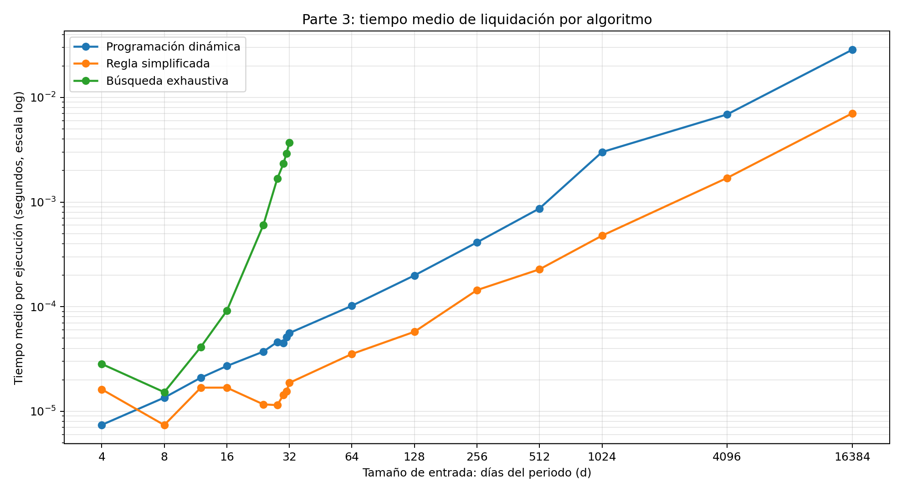
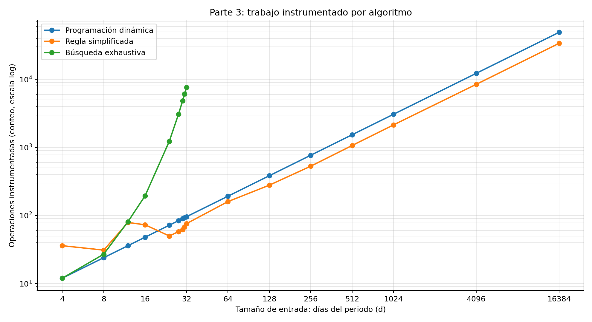

# Laboratorio 4 y proyecto final — Análisis de Algoritmos

**Institución:** Instituto Tecnológico Metropolitano (ITM)  
**Asignatura:** Análisis de Algoritmos  
**Periodo académico:** 2026-2  
**Grupo:** 10 — Asíncrono  
**Caso asignado:** Caso 1 — Conciliación nocturna del recaudo del Sistema Integrado de Transporte del Valle Metropolitano (SITVM)  
**Operación desarrollada:** Operación 4 — Liquidación del tope tarifario

**Integrantes:**

- Juan Felipe Cadavid Zabala
- Paula Andrea Calderón Quintero
- Juan David Velásquez Murillo
- Jhon Fernando Sánchez Álvarez

**Fechas de entrega:** Laboratorio 4, 18 de noviembre de 2026; proyecto final, 23 de noviembre de 2026.

En este repositorio estudiamos cómo calcular el costo mínimo de los viajes mensuales de una tarjeta del SITVM. Comparamos la programación dinámica, una búsqueda exhaustiva y una interpretación de la regla simplificada descrita en el caso. Utilizamos pruebas automáticas y datos sintéticos para comprobar los resultados y analizar el rendimiento.

El documento presenta **las cuatro partes del Laboratorio 4**. Esta entrega desarrolla la **operación 4**; para el proyecto final corresponde incorporar otra operación del Caso 1 y completar su análisis junto con el informe general. En la entrega final, el **PDF debe coincidir con el contenido del README**, y el historial de commits debe permitir identificar los aportes de los integrantes.

**Contenido:** [Ejecución](#cómo-ejecutar-el-proyecto) · [Parte 1: Modelado](#parte-1--modelar-y-resolver-a-mano) · [Parte 2: Implementación](#parte-2--implementar-y-verificar) · [Parte 3: Mediciones](#parte-3--medir-y-graficar) · [Parte 4: Análisis](#parte-4--análisis-de-los-resultados)

---

## Cómo ejecutar el proyecto

### Requisitos

- Tener instalado **Python 3.10 o una versión posterior**.
- Tener acceso a una terminal, como PowerShell o la terminal de Visual Studio Code.
- Instalar la dependencia indicada en `requirements.txt` (`matplotlib`, utilizada para las gráficas).

No se necesita una interfaz gráfica, una base de datos ni un servidor para ejecutar los ejercicios. El proyecto funciona desde la terminal.

### 1. Descargar y abrir el repositorio

Si todavía no tenemos una copia local, ejecutamos:

```powershell
git clone https://github.com/jfcadavid/Proyecto-Final-Analisis-Algoritmos.git
cd Proyecto-Final-Analisis-Algoritmos
```

Si el proyecto ya está descargado, abrimos su carpeta en Visual Studio Code y nos ubicamos en la raíz del repositorio. Para traer los cambios más recientes podemos usar `git pull origin main`, siempre que hayamos guardado antes nuestros cambios locales.

### 2. Instalar la dependencia

Desde la carpeta principal:

```powershell
python -m pip install -r requirements.txt
```

En Windows, si el comando `python` no está disponible, podemos utilizar `py` en su lugar. En otros sistemas, el comando puede ser `python3`.

### 3. Ejecutar las pruebas de la Parte 2

```powershell
python src/tope_tarifario/pruebas.py
```

Cuando todas las comprobaciones pasan, el programa muestra:

```text
Pruebas correctas: casos límite, ejemplo y 30 instancias aleatorias.
```

Entre otras verificaciones, se comprueba el ejemplo manual de ocho días: el costo mínimo es **$39.900** y la regla simplificada que definimos produce **$45.500**.

### 4. Ejecutar los experimentos de la Parte 3

```powershell
python src/tope_tarifario/medicion.py
```

Este comando utiliza los algoritmos que ya están implementados y genera los resultados dentro de `graficas/tope_tarifario/`:

- `resultados.csv`: tiempos promedio, cantidades de operaciones y costos.
- `tiempo_vs_n.png`: comparación de tiempos frente al número de días.
- `operaciones_vs_n.png`: comparación de operaciones frente al número de días.

La búsqueda exhaustiva **solo se ejecuta con tamaños pequeños**, porque su trabajo aumenta rápidamente. Los tiempos pueden cambiar entre computadores; por eso, las gráficas del informe se basan en los resultados que medimos y guardamos en el CSV.

### Estructura del proyecto

```text
Proyecto-Final-Analisis-Algoritmos/
├── README.md
├── requirements.txt
├── src/
│   └── tope_tarifario/
│       ├── estrategia.py
│       ├── exhaustivo.py
│       ├── regla_actual.py
│       ├── datos.py
│       ├── pruebas.py
│       └── medicion.py
└── graficas/
    └── tope_tarifario/
        ├── resultados.csv
        ├── tiempo_vs_n.png
        └── operaciones_vs_n.png
```

---

## Parte 1 — Modelar y resolver a mano

### 1.1. Análisis del problema

#### Contexto del Caso 1

El SITVM opera el metro, dos líneas de cable y buses alimentadores para una población metropolitana cercana a cuatro millones de habitantes. Los usuarios registran sus viajes con tarjetas sin contacto y, durante la noche, el sistema procesa las validaciones recibidas.

El proceso realiza cuatro operaciones: **deduplicar validaciones**, **ordenarlas por tarjeta y hora**, **detectar franjas de congestión** y **liquidar el tope tarifario**. Actualmente tarda **más de ocho horas**, aunque las operaciones 1 y 2 deben ajustarse a una ventana de **cuatro horas, de 00:00 a 04:00**. La operación 4 comparte esa ventana en el cierre de mes.

Para este laboratorio trabajamos la **operación 4**. El problema consiste en calcular cuál es la combinación más barata de pasajes y pases que cubre los viajes mensuales de una tarjeta personalizada. Si al usuario se le cobró de más, el sistema debe devolverle exactamente la diferencia como saldo en la tarjeta.

El procedimiento actual intenta probar todas las combinaciones, pero puede tardar demasiado cuando hay viajes durante muchos días. En esos casos utiliza una regla simplificada que no siempre consigue el menor costo.

#### Entradas, salidas y unidades

La entrada principal es `viajes_por_dia`, una lista de enteros no negativos: cada posición representa un día y cada valor indica cuántos viajes se realizaron. Un día sin viajes se representa con `0`.

Para calcular la devolución, la función `liquidar_tope()` también recibe `cobrado`, el valor realmente descontado durante el periodo, expresado en **pesos colombianos (COP)**.

Las tarifas del **perfil general** son:

| Producto | Precio (COP) | Cobertura |
|---|---:|---|
| Pasaje sencillo | $3.900 | Un viaje |
| Pase diario | $9.500 | Viajes ilimitados durante un día calendario |
| Pase semanal | $36.000 | Viajes ilimitados durante siete días consecutivos |
| Pase mensual | $135.000 | Viajes ilimitados durante treinta días consecutivos |

El caso menciona tarifas diferenciales para otros perfiles, pero no proporciona sus valores. Por eso, los cálculos de este laboratorio utilizan las tarifas del perfil general.

La operación debe entregar:

1. **Costo mínimo:** valor más bajo que cubre todos los viajes del periodo.
2. **Devolución:** diferencia positiva entre lo cobrado y ese costo mínimo.

```text
Devolución = max(0, cobrado - costo_mínimo)
```

#### Restricciones y volumen del caso

- Todos los viajes válidos deben quedar cubiertos y ninguna validación duplicada debe cobrarse dos veces.
- La devolución debe ser **exacta**, sin beneficiar de más ni perjudicar al usuario.
- El proceso debe conservar la trazabilidad y no modificar los registros originales.
- Los pases semanales y mensuales cubren días **consecutivos**.
- El SITVM tiene aproximadamente **3.200.000 tarjetas emitidas** y unas **950.000 se utilizan al menos una vez al mes**.
- En un día hábil típico se reciben cerca de **1.400.000 validaciones** y entre el **4 % y el 9 %** pueden llegar repetidas.
- El servidor es único, no utiliza procesamiento paralelo y consume aproximadamente **500 W** bajo carga sostenida.
- La operación 4 comparte, durante el cierre mensual, la ventana de cuatro horas con las operaciones 1 y 2.

Las cifras de validaciones y duplicados describen el proceso general. Nuestra función de tope tarifario recibe los **viajes diarios de una tarjeta ya depurados**, no todos los registros originales.

Como referencia energética del proceso completo, si el servidor mantuviera una potencia de 500 W durante más de ocho horas, consumiría **más de 4 kWh** en ese periodo. Esta es una estimación para **todo el proceso nocturno**; no podemos atribuirla únicamente a la operación 4.

#### Supuestos de interpretación

Para mantener las mismas reglas en la explicación, el código y las pruebas, trabajamos con estos supuestos:

- Los viajes se presentan en orden cronológico. Un mes real puede tener 28, 29, 30 o 31 días.
- La cantidad de viajes de un día es un entero no negativo.
- Si no hay viajes en un día, avanzamos al siguiente sin comprar ningún producto.
- Un pase semanal o mensual puede comenzar en cualquier día del periodo. Si termina después del último día evaluado, no añadimos cobros por los días que sobren.
- Los precios y las devoluciones se calculan con valores enteros en pesos.
- Si dos combinaciones cuestan lo mismo, ambas son óptimas; el programa conserva la primera que encuentra con ese costo.
- Para las pruebas tomamos como entrada los viajes válidos, sin duplicados cobrables.
- La regla simplificada del SITVM no está definida con todos sus detalles. Por eso documentamos una **interpretación reproducible** para comparar algoritmos, sin afirmar que conocemos el programa real del sistema.

### 1.2. Diseño de la solución: programación dinámica

#### ¿Por qué escogimos esta estrategia?

Escogimos **programación dinámica** porque una compra puede cubrir varios días y afectar las decisiones siguientes. Si compramos un pase semanal desde el día 2, quedan cubiertos los días 2 al 8 y la siguiente decisión comienza en el día 9.

Existe **subestructura óptima** porque, después de una compra, los días que faltan también deben cubrirse al menor costo posible. Además, hay **subproblemas repetidos**: diferentes combinaciones pueden llevar al mismo día pendiente. La programación dinámica guarda esos resultados para no calcularlos nuevamente.

#### Estado, recurrencia y caso base

Definimos `C(t)` como el costo mínimo para cubrir los viajes desde el día `t` hasta el final de un periodo de `d` días. La respuesta es `C(1)`.

Cuando hay viajes en el día `t`, comparamos tres posibilidades:

```text
C(t) = min(
    min(3900 × viajes[t], 9500) + C(t + 1),
    36000 + C(min(t + 7, d + 1)),
    135000 + C(min(t + 30, d + 1))
)
```

- **Primera opción:** pagar únicamente el día actual con pasajes sencillos o un pase diario y continuar en el siguiente.
- **Segunda opción:** comprar un pase semanal y continuar siete días después.
- **Tercera opción:** comprar un pase mensual y continuar treinta días después.

En esta explicación numeramos los días desde 1. Como Python utiliza índices desde 0, el viaje del día `t` se consulta en `viajes_por_dia[t - 1]`.

Cuando no hay viajes, `C(t) = C(t + 1)`. El **caso base** es `C(d + 1) = 0`, porque ya no queda nada por pagar. Utilizamos `min(..., d + 1)` para no consultar estados fuera del periodo.

La tabla se llena **desde el último día hasta el primero**, pues el costo de un día depende de los costos de los días posteriores. También guardamos qué compra dio el mínimo para recuperar los productos elegidos.

### 1.3. Ejemplo de ocho días resuelto a mano

Utilizamos una lista ficticia de ocho días para explicar el procedimiento, tal como pide el laboratorio:

```python
viajes_por_dia = [1, 3, 3, 3, 3, 0, 0, 3]
```

| Día | 1 | 2 | 3 | 4 | 5 | 6 | 7 | 8 |
|---|---:|---:|---:|---:|---:|---:|---:|---:|
| Viajes | 1 | 3 | 3 | 3 | 3 | 0 | 0 | 3 |

Para un día con **un viaje**, conviene pagar $3.900. Para uno con **tres viajes**, el pase diario cuesta $9.500 frente a los $11.700 de tres pasajes sencillos. Los días sin viajes no generan cobro.

Comenzamos con `C(9) = 0` y calculamos hacia atrás:

| Día | Viajes | Pagar hoy y continuar | Pase semanal y continuar | Pase mensual y continuar | Costo mínimo `C(t)` |
|---:|---:|---:|---:|---:|---:|
| 9 | — | — | — | — | **$0** |
| 8 | 3 | $9.500 | $36.000 | $135.000 | **$9.500** |
| 7 | 0 | Sin compra | — | — | **$9.500** |
| 6 | 0 | Sin compra | — | — | **$9.500** |
| 5 | 3 | $9.500 + $9.500 = $19.000 | $36.000 | $135.000 | **$19.000** |
| 4 | 3 | $9.500 + $19.000 = $28.500 | $36.000 | $135.000 | **$28.500** |
| 3 | 3 | $9.500 + $28.500 = $38.000 | $36.000 | $135.000 | **$36.000** |
| 2 | 3 | $9.500 + $36.000 = $45.500 | $36.000 | $135.000 | **$36.000** |
| 1 | 1 | $3.900 + $36.000 = $39.900 | $36.000 + $9.500 = $45.500 | $135.000 | **$39.900** |

**Así llegamos al resultado:**

1. En el **día 8**, pagar ese día cuesta $9.500: `C(8) = 9500`.
2. Los **días 7 y 6** no tienen viajes: `C(7) = C(6) = 9500`.
3. En el **día 5**, pagar $9.500 y sumar lo pendiente da $19.000: `C(5) = 19000`.
4. En el **día 4**, pagar ese día y lo pendiente da $28.500: `C(4) = 28500`.
5. En el **día 3**, pagar solo ese día y continuar cuesta $38.000, pero un pase semanal cuesta $36.000: `C(3) = 36000`.
6. En el **día 2**, el pase semanal de $36.000 cubre hasta el día 8 y resulta mejor que pagar hoy y continuar por $45.500: `C(2) = 36000`.
7. En el **día 1**, el viaje sencillo más `C(2)` cuesta $39.900. El pase semanal desde el día 1 costaría $45.500 y el mensual $135.000.

```text
C(1) = min(39900, 45500, 135000) = 39900
```

La combinación óptima es:

| Día de compra | Producto | Días cubiertos | Precio |
|---:|---|---|---:|
| 1 | Un pasaje sencillo | Día 1 | $3.900 |
| 2 | Un pase semanal | Días 2 al 8 | $36.000 |
| | **Costo total** | | **$39.900** |

Para mostrar la devolución, supongamos que los 16 viajes de la lista se cobraron inicialmente a $3.900 cada uno:

```text
Cobrado = 16 × 3900 = 62400 pesos
Costo mínimo = 39900 pesos
Devolución = 62400 - 39900 = 22500 pesos
```

En ese **ejemplo hipotético**, corresponde devolver **$22.500**. No representa una tarjeta real del SITVM.

### 1.4. Análisis comparativo: la regla actual y su contraejemplo

#### Cómo interpretamos la regla simplificada

El caso señala que la organización compara los pasajes sencillos con el pase diario y aplica pases semanales o mensuales cuando la suma supera su precio. No especifica cómo elige exactamente el día en que comienza cada pase.

Para poder hacer la comparación, definimos una regla concreta:

1. Calculamos para cada día el menor precio entre pasajes sencillos y pase diario.
2. Desde el primer día con viajes sin cubrir, sumamos los costos individuales de los próximos **30 días**. Si superan $135.000, compramos un pase mensual desde ese día.
3. Si no se aplica el mensual, revisamos los próximos **7 días**. Si su suma supera $36.000, compramos un pase semanal desde ese día.
4. Si no conviene ninguno, pagamos solo el día actual.
5. Saltamos los días que ya cubre un pase y continuamos hasta terminar el periodo.

Utilizamos esta misma interpretación en [`regla_actual.py`](src/tope_tarifario/regla_actual.py), en las pruebas y en las mediciones. **No afirmamos que sea la implementación exacta del sistema real**.

#### Contraejemplo calculado

Para la misma lista de ocho días, el costo de pagar cada día por separado es:

| Día | Viajes | Menor costo individual |
|---:|---:|---:|
| 1 | 1 | $3.900 |
| 2 | 3 | $9.500 |
| 3 | 3 | $9.500 |
| 4 | 3 | $9.500 |
| 5 | 3 | $9.500 |
| 6 | 0 | $0 |
| 7 | 0 | $0 |
| 8 | 3 | $9.500 |
| **Total** | **16** | **$51.400** |

Al comenzar en el día 1, los costos individuales de los **días 1 al 7** suman $41.900. Como superan $36.000, nuestra regla compra un pase semanal **desde el día 1**. El día 8 queda fuera y requiere un pase diario de $9.500.

| Estrategia | Compras | Costo |
|---|---|---:|
| Regla simplificada | Semanal desde el día 1 + diario del día 8 | $45.500 |
| Programación dinámica | Sencillo del día 1 + semanal desde el día 2 | **$39.900** |
| **Diferencia** | | **$5.600** |

La regla simplificada compra el pase semanal demasiado pronto. La programación dinámica compara otras fechas de inicio y encuentra que comenzar ese pase en el día 2 permite ahorrar **$5.600**. Este es el contraejemplo que usamos en la Parte 2 para verificar el código.

#### ¿Cuándo bastaría una estrategia voraz?

Si solo existieran pasajes sencillos y pases diarios, sin pases que cubrieran varios días, podríamos elegir lo más barato **día por día**. La compra de hoy no afectaría el costo de mañana:

```text
Costo total = suma(min(3900 × viajes_del_día, 9500))
```

Esa decisión local sería suficiente. En el problema real, los pases semanales y mensuales relacionan varios días, por lo que necesitamos comparar alternativas antes de decidir.

---

## Parte 2 — Implementar y verificar

### 2.1. Organización de la implementación

Desarrollamos los algoritmos en **Python**, dentro de `src/tope_tarifario/`, siguiendo las firmas solicitadas por el profesor. No utilizamos bibliotecas que resuelvan directamente el problema de optimización. Cada archivo tiene una responsabilidad diferente y así podemos probar las soluciones sin mezclarlas.

| Archivo | Función dentro del proyecto |
|---|---|
| [`estrategia.py`](src/tope_tarifario/estrategia.py) | Encuentra el costo mínimo mediante programación dinámica y calcula la devolución. |
| [`exhaustivo.py`](src/tope_tarifario/exhaustivo.py) | Busca el costo mínimo sin guardar subproblemas, como referencia exacta. |
| [`regla_actual.py`](src/tope_tarifario/regla_actual.py) | Ejecuta nuestra interpretación de la regla simplificada. |
| [`datos.py`](src/tope_tarifario/datos.py) | Genera listas sintéticas reproducibles de viajes. |
| [`pruebas.py`](src/tope_tarifario/pruebas.py) | Comprueba resultados mediante `assert`. |
| [`medicion.py`](src/tope_tarifario/medicion.py) | Mide tiempos y operaciones y crea las gráficas y el CSV. |

### 2.2. `estrategia.py` — Programación dinámica

Este es nuestro algoritmo principal. Recorre los días desde el final hacia el principio y guarda en una tabla el menor costo de cubrir los viajes pendientes. En cada día con viajes compara pagar ese día, comprar un pase semanal o comprar uno mensual. Así no repite cálculos que ya tiene guardados.

Sus funciones principales son:

- `costo_minimo(viajes_por_dia)`: devuelve el menor costo en pesos.
- `liquidar_tope(viajes_por_dia, cobrado)`: devuelve la diferencia positiva entre el cobro real y el mínimo.
- `compras_optimas(viajes_por_dia)`: recupera las compras de una combinación óptima.
- `contar_operaciones(viajes_por_dia)`: cuenta las alternativas revisadas.

Con nuestro ejemplo de ocho días, encuentra un sencillo de $3.900 y un semanal de $36.000, para un total de **$39.900**.

### 2.3. `exhaustivo.py` — Búsqueda exhaustiva

Implementamos una solución recursiva que explora las alternativas desde cada día pendiente y se queda con el menor costo encontrado. A diferencia de la programación dinámica, **no guarda los resultados anteriores**, así que puede repetir muchas veces los mismos cálculos.

- `costo_exhaustivo(viajes_por_dia)`: devuelve el menor costo después de explorar las posibilidades.
- `contar_operaciones(viajes_por_dia)`: cuenta las alternativas exploradas, incluidas las repetidas.

Nos sirve como una **referencia exacta** para comprobar que la programación dinámica llega al mismo resultado. En el ejemplo manual, las dos devuelven **$39.900**. Solo ejecutamos la exhaustiva con periodos cortos porque crece rápidamente.

### 2.4. `regla_actual.py` — Regla simplificada

Aquí programamos el procedimiento que definimos en los supuestos: primero calculamos el menor costo individual por día, revisamos si conviene un pase mensual, luego uno semanal y, si ninguno cumple la condición, pagamos el día actual.

- `costo_regla_actual(viajes_por_dia)`: devuelve el cobro según esa regla.
- `contar_operaciones(viajes_por_dia)`: cuenta las revisiones realizadas.
- `_resolver(viajes_por_dia)`: función auxiliar que calcula el costo y el conteo.

Con la lista de ocho días, esta regla obtiene **$45.500**, frente a los **$39.900** de programación dinámica. La utilizamos para mostrar que una solución rápida no siempre garantiza el cobro correcto.

### 2.5. `datos.py` — Generación de datos sintéticos

Como no contamos con registros reales de tarjetas, usamos la biblioteca `random` para crear listas de viajes. La función `generar_viajes()` recibe el número de días, una semilla, el máximo de viajes diarios y la probabilidad de obtener un día sin viajes.

La semilla predeterminada es **2026**, por lo que podemos repetir una prueba con los mismos parámetros y obtener la misma lista.

```python
from datos import generar_viajes

viajes = generar_viajes(
    dias=8,
    semilla=2026,
    max_viajes=5,
    probabilidad_cero=0.05,
)
print(viajes)
```

Este ejemplo se puede ejecutar desde `src/tope_tarifario/` o dentro de un programa que importe el módulo. Los datos creados son **sintéticos**; no representan usuarios reales.

### 2.6. `pruebas.py` — Verificación de resultados

Utilizamos `assert` para comprobar que los resultados coincidan con lo esperado. Verificamos la lista vacía, días sin viajes, un día con uno o varios viajes, meses de 30 y 31 días, la devolución exacta y que las funciones no cambien la lista original.

También probamos la lista que resolvimos a mano:

```python
ejemplo = [1, 3, 3, 3, 3, 0, 0, 3]

assert costo_minimo(ejemplo) == 39900
assert costo_exhaustivo(ejemplo) == 39900
assert costo_regla_actual(ejemplo) == 45500
assert liquidar_tope(ejemplo, 62400) == 22500
```

Además, generamos **30 instancias aleatorias pequeñas**, con semillas fijas y entre 1 y 10 días. En cada una comparamos el costo de programación dinámica y el de búsqueda exhaustiva; también comprobamos que la regla simplificada no quede por debajo del mínimo y que la devolución sea correcta.

El programa se ejecuta con:

```powershell
python src/tope_tarifario/pruebas.py
```

La ejecución realizada devolvió el mensaje:

```text
Pruebas correctas: casos límite, ejemplo y 30 instancias aleatorias.
```

### 2.7. `medicion.py` — Preparación de los experimentos

Este archivo llama a **los algoritmos anteriores**; no vuelve a programar sus soluciones. Con `perf_counter()` mide cuánto tarda cada uno y utiliza los contadores para registrar las operaciones. Genera las instancias antes de comenzar a cronometrar y utiliza la misma entrada para cada algoritmo que se compare.

Las funciones principales son `repeticiones_para()`, `medir_tiempo()`, `medir()`, `guardar_csv()`, `guardar_grafica()` y `main()`.

Los datos de las mediciones y las gráficas se presentan a continuación, en la Parte 3.

---

## Parte 3 — Medir y graficar

### 3.1. Cómo realizamos los experimentos

Ejecutamos los tres algoritmos con **datos sintéticos**, usando la semilla `2026` y viajes en todos los días de cada instancia. Esto permite observar cómo crece el trabajo cuando aumenta el número de días con viajes.

Para medir, generamos una sola lista por tamaño y la compartimos entre los algoritmos. Cronometramos **únicamente la función**, mediante `time.perf_counter()`, y calculamos el promedio de varias ejecuciones. El conteo de operaciones se hace fuera del cronómetro.

- **Tamaños pequeños:** 4, 8, 12, 16, 24, 28, 30, 31 y 32 días. Aquí comparamos programación dinámica, búsqueda exhaustiva y regla simplificada.
- **Tamaños grandes:** 64, 128, 256, 512, 1.024, 4.096 y 16.384 días. Aquí solo ejecutamos programación dinámica y regla simplificada.

Incluimos parejas donde el tamaño se duplica, como **4–8**, **8–16** y **16–32**. No utilizamos búsqueda exhaustiva con entradas grandes para evitar mediciones excesivamente largas.

**Los tamaños superiores a 31 días son pruebas de escalabilidad, no meses reales del SITVM.** Las cantidades de operaciones representan el trabajo que definimos en los contadores de nuestros programas, no instrucciones de procesador.

Los datos completos están en [`resultados.csv`](graficas/tope_tarifario/resultados.csv).

### 3.2. Gráfica de tiempo de ejecución



La gráfica muestra que la programación dinámica mantiene un crecimiento mucho más controlado que la búsqueda exhaustiva. La regla simplificada también es rápida, aunque en algunos casos no encuentra el costo mínimo.

Estos son algunos tiempos medidos en el computador donde ejecutamos los experimentos, convertidos a **milisegundos**:

| Días | Programación dinámica (ms) | Búsqueda exhaustiva (ms) | Regla simplificada (ms) |
|---:|---:|---:|---:|
| 8 | 0,0135 | 0,0152 | 0,0074 |
| 16 | 0,0271 | 0,0913 | 0,0168 |
| 24 | 0,0372 | 0,6045 | 0,0117 |
| 32 | 0,0559 | 3,6968 | 0,0187 |

### 3.3. Gráfica de operaciones



Esta gráfica permite comparar el crecimiento del trabajo sin depender únicamente del tiempo del computador.

Por ejemplo, con **16 días**, la programación dinámica contabiliza **48 operaciones** y la exhaustiva **195**. Con **32 días**, registran **96** y **7.671**, respectivamente. En la búsqueda exhaustiva se repiten muchas exploraciones, mientras que la programación dinámica reutiliza los resultados guardados.

Ambas gráficas tienen título, ejes rotulados y leyenda. Utilizan **escalas logarítmicas** para que podamos visualizar datos muy diferentes en una misma figura.

### 3.4. Verificación de costos durante las mediciones

Dentro del propio experimento comprobamos con `assert` que la programación dinámica y la exhaustiva obtuvieran el mismo valor óptimo para los **nueve tamaños pequeños**. Las verificaciones terminaron correctamente.

La regla simplificada produjo un costo superior al mínimo en algunas instancias:

| Días | Costo mínimo (COP) | Regla simplificada (COP) | Cobro adicional (COP) |
|---:|---:|---:|---:|
| 16 | $79.800 | $91.000 | **$11.200** |
| 24 | $119.700 | $135.000 | **$15.300** |
| 128 | $579.900 | $583.800 | **$3.900** |
| 256 | $1.158.900 | $1.215.000 | **$56.100** |

Las entradas de 128 y 256 días son experimentos sintéticos de crecimiento, no meses reales. Estos resultados muestran que una regla más rápida puede producir un cobro mayor que el mínimo que exige el caso.

---

## Parte 4 — Análisis de los resultados

### 4.1. Diseño de la solución: recurrencia y orden de cálculo

La recurrencia de la programación dinámica, la explicación de sus tres opciones, el caso base `C(d + 1) = 0` y el llenado de la tabla de atrás hacia adelante están desarrollados en **[la Parte 1, apartado 1.2](#12-diseño-de-la-solución-programación-dinámica)**. Los aplicamos al ejemplo completo del **[apartado 1.3](#13-ejemplo-de-ocho-días-resuelto-a-mano)**.

### 4.2. Evaluación del desempeño: complejidad temporal y espacial

Llamamos `d` a la cantidad de días y `a` a la cantidad de días con viajes.

| Algoritmo | Complejidad temporal | Complejidad espacial | Explicación |
|---|---|---|---|
| Programación dinámica | **Θ(d)** | **Θ(d)** | Recorre los días una vez, compara hasta tres alternativas y guarda costos y decisiones. |
| Búsqueda exhaustiva | **Exponencial en el peor caso**, cuando crecen los días con viajes | **O(d)** | Explora las combinaciones recursivamente sin guardar resultados; utiliza la pila de llamadas. |
| Regla simplificada | **Θ(d)** | **Θ(d)** | Recorre los días y revisa ventanas de hasta 7 o 30 días, longitudes fijas, y guarda costos diarios. |

La programación dinámica tiene un costo lineal porque para cada día hace un número fijo de comparaciones. La búsqueda exhaustiva puede tomar distintas decisiones desde el mismo día muchas veces; por eso su trabajo aumenta rápidamente cuando hay viajes en todos o casi todos los días. La regla simplificada también tiene crecimiento lineal, pero **no garantiza** el mínimo exacto.

### 4.3. Evaluación del desempeño: lo medido frente a lo esperado

Para contrastar teoría y práctica tomamos los tamaños **16 y 32 días**, porque el segundo es el doble del primero. Ambas entradas tenían viajes todos los días.

| Algoritmo | Tiempo con 16 días | Tiempo con 32 días | Factor de tiempo | Operaciones 16 → 32 | Factor de operaciones |
|---|---:|---:|---:|---:|---:|
| Programación dinámica | 0,0271 ms | 0,0559 ms | **2,07×** | 48 → 96 | **2,00×** |
| Búsqueda exhaustiva | 0,0913 ms | 3,6968 ms | **40,49×** | 195 → 7.671 | **39,34×** |
| Regla simplificada | 0,0168 ms | 0,0187 ms | **1,11×** | 73 → 76 | **1,04×** |

Dividimos el resultado de 32 días entre el de 16. Por ejemplo, en programación dinámica `96 / 48 = 2`; en exhaustiva `7671 / 195 ≈ 39,34`.

La programación dinámica se comportó como esperábamos para una estrategia lineal: al duplicar los días, sus operaciones se duplicaron y el tiempo aumentó unas dos veces. La búsqueda exhaustiva creció mucho más, de acuerdo con su comportamiento exponencial.

La regla simplificada aumentó poco en esta pareja porque puede comprar pases que cubren varios días y saltarse parte de las decisiones. **Eso no significa que su complejidad sea constante**: con otras listas de viajes debe revisar más días y ventanas.

Los tiempos de entradas pequeñas pueden variar por el entorno de ejecución de Python. Por eso utilizamos también los contadores y las gráficas, en lugar de basarnos en una única medición.

### 4.4. Evaluación del desempeño: escala real y ventana nocturna

El caso informa que alrededor de **950.000 tarjetas** se usan al menos una vez al mes. Como escenario exigente de estimación, suponemos que se liquidan las 950.000, que el periodo tiene **31 días** y que todas registran viajes cada día. Esto es una **hipótesis de cálculo**; no conocemos el número exacto de tarjetas personalizadas ni su frecuencia real de uso.

Cada tarjeta se procesa por separado y el servidor del caso no utiliza paralelismo. Por eso, manteniendo **fijos los 31 días por tarjeta**, estimamos el total multiplicando el tiempo medio medido para 31 días por la cantidad de tarjetas:

```text
Tiempo estimado del cierre = tiempo medido por tarjeta × 950000
```

| Algoritmo | Tiempo medio medido por tarjeta (31 días) | Tiempo estimado para 950.000 tarjetas |
|---|---:|---:|
| Programación dinámica | 0,0511 ms | **48,56 segundos** |
| Regla simplificada | 0,0155 ms | **14,74 segundos** |
| Búsqueda exhaustiva | 2,9197 ms | **2.773,74 segundos (46,23 minutos)** |

Este cálculo **no supone que la búsqueda exhaustiva crezca linealmente con el número de días**. Solo suma muchas tarjetas con el mismo tamaño de periodo. En cambio, si aumentaran los días con viajes dentro de cada tarjeta, la búsqueda exhaustiva podría crecer de manera exponencial.

La ventana de cierre es de **cuatro horas (00:00–04:00)**. En esta estimación aislada, las tres alternativas cabrían por separado para el escenario supuesto de 31 días. Sin embargo, **no podemos afirmar que todo el proceso nocturno cumpla la ventana**, porque faltan los tiempos de las operaciones 1 y 2, la lectura y escritura de registros, la integración y las diferencias de hardware. Las más de ocho horas actuales corresponden al proceso completo, no a una medición de nuestra función.

Para ver el riesgo del enfoque exhaustivo, consideramos un periodo sintético de **64 días con viajes todos los días**, que no representa un mes real. En el algoritmo recursivo, el conteo teórico cumple, para días con viajes:

```text
N(d) = 3 + N(d - 1) + N(d - 7) + N(d - 30)
```

Tomando `N(d) = 0` cuando `d ≤ 0`, el conteo pasa de **7.671 alternativas en 32 días** a aproximadamente **11.300.145 en 64 días**. Si extrapolamos el tiempo mediante la proporción de operaciones observada a 32 días, serían cerca de **5,45 segundos por tarjeta**, y unas **60 jornadas completas** de cómputo para 950.000 tarjetas. Esta última cifra **no es una medición**: solamente ilustra cómo el crecimiento exponencial puede volver inviable la búsqueda exhaustiva en periodos más largos.

### 4.5. Implicaciones éticas, sociales y ambientales

#### Consumo energético

El caso indica que el servidor consume aproximadamente **500 W**, es decir, **0,5 kW** bajo carga sostenida. Estimamos la energía de una ejecución mediante:

```text
Energía (kWh) = Potencia (kW) × Tiempo (horas)
```

Con los tiempos estimados para **950.000 tarjetas de 31 días**, obtenemos:

| Algoritmo | Tiempo por cierre | Energía estimada por cierre | Energía estimada en 12 cierres |
|---|---:|---:|---:|
| Programación dinámica | 48,56 s | **0,00674 kWh** | **0,08093 kWh/año** |
| Regla simplificada | 14,74 s | **0,00205 kWh** | **0,02457 kWh/año** |
| Búsqueda exhaustiva | 46,23 min | **0,38524 kWh** | **4,62291 kWh/año** |

Para programación dinámica, por ejemplo:

```text
0,5 × (48,56 / 3600) ≈ 0,00674 kWh por cierre
```

La diferencia anual estimada entre la regla simplificada y la programación dinámica es:

```text
(0,08093 - 0,02457) ≈ 0,05635 kWh/año
```

Con estas mediciones **no podemos decir que la programación dinámica ahorre energía frente a la regla simplificada**: en nuestro escenario utiliza aproximadamente **0,05635 kWh más al año**. La recomendamos por la exactitud del resultado. Frente a la búsqueda exhaustiva, la programación dinámica representa una reducción estimada de aproximadamente **4,54 kWh al año**.

Estas cifras se calculan a partir de tiempos medidos en nuestro computador y una potencia supuesta constante de 500 W. **No son lecturas del servidor real** y no incluyen el consumo en reposo, las otras operaciones ni las tareas de entrada y salida.

#### Consecuencias para los usuarios

Un cobro duplicado o una liquidación incorrecta afecta directamente el saldo disponible para viajar. El caso advierte que muchos usuarios frecuentes y personas con tarifa diferencial cuentan con menores ingresos. Por eso, para este problema, **la exactitud es tan importante como el tiempo**: un algoritmo rápido que cobra de más no cumple la condición del negocio.

También importa el momento de acreditar la devolución. Si el proceso termina tarde, la persona no recibe oportunamente el saldo que le corresponde. Para reducir ese riesgo, planteamos comprobar resultados con una solución exacta en casos pequeños, conservar registros de las decisiones y no modificar las validaciones originales.

#### Datos personales, normas y buenas prácticas

Las validaciones de una tarjeta personalizada pueden mostrar desplazamientos y hábitos de una persona. Por esa razón, el tratamiento de sus datos debe considerar los principios de finalidad, seguridad, acceso restringido y calidad de la información contemplados en la **[Ley 1581 de 2012](https://www.funcionpublica.gov.co/eva/gestornormativo/norma.php?i=49981)** sobre protección de datos personales.

Además, la **[Ley 336 de 1996](https://www.funcionpublica.gov.co/eva/gestornormativo/norma.php?i=346)** establece el marco general del transporte público en Colombia. En el contexto del ejercicio, esto refuerza la necesidad de tratar los cobros y las devoluciones como decisiones que deben poder explicarse y revisarse.

Como medidas de diseño, proponemos utilizar **datos sintéticos en las pruebas públicas**, limitar el acceso a los datos reales cuando exista una implementación de producción, conservar las validaciones originales y poder reproducir los cálculos ante una reclamación. Nuestro programa académico no implementa por sí solo todo un sistema de protección de datos ni sustituye una revisión jurídica de una solución real.

#### Crecimiento futuro del sistema

El caso plantea una posible tercera línea de cable y un crecimiento del **30 % en las validaciones diarias**. Esto aumentaría la carga del proceso general, especialmente de deduplicación y ordenamiento, que no desarrollamos en este laboratorio.

Para la operación 4, la programación dinámica mantiene un trabajo proporcional al número de días por tarjeta. Si también aumentara **30 % la cantidad de tarjetas que se deben liquidar**, manteniendo constantes las demás condiciones, el tiempo total estimado crecería aproximadamente en esa misma proporción. No suponemos que un 30 % más de validaciones implique necesariamente un 30 % más de tarjetas.

### 4.6. Análisis comparativo y recomendación

**Recomendamos la programación dinámica** para liquidar el tope tarifario del SITVM porque encuentra el costo mínimo exacto, evita repetir subproblemas y crece de forma controlada con los días del periodo.

En las pruebas pequeñas dio el mismo resultado que la búsqueda exhaustiva, pero utilizó muchas menos operaciones cuando aumentó la entrada. La regla simplificada fue **más rápida** en algunas mediciones, incluyendo la de 31 días; sin embargo, **no garantiza el menor cobro**. En nuestro contraejemplo, cobró $45.500 frente a los $39.900 de la programación dinámica, una diferencia de $5.600.

La ganancia principal sería **liquidar y devolver correctamente**, no superar la velocidad de la regla simplificada. Frente al método exhaustivo, además, la programación dinámica evita que el tiempo crezca de forma explosiva cuando se acumulan días con viajes.

Antes de utilizar una versión real habría que validar las tarifas diferenciales, confirmar la interpretación de los pases y medir la solución integrada con las demás operaciones del cierre nocturno. También sería necesario comprobar el rendimiento en el servidor de la organización, porque nuestros tiempos corresponden a un experimento académico con datos sintéticos.

---

## Conclusiones

Al desarrollar la operación de tope tarifario pudimos comprobar que no siempre basta con escoger el pase que parece más barato en un momento. Un pase semanal comprado un día antes puede dejar viajes por fuera y aumentar el costo total.

La **programación dinámica** nos permitió resolver ese problema de forma exacta. La **búsqueda exhaustiva** nos ayudó a verificar los resultados, aunque su crecimiento la hace poco conveniente para entradas grandes. La **regla simplificada** realizó menos trabajo en algunas pruebas, pero puede generar cobros superiores al mínimo.

Las mediciones y las gráficas respaldan el comportamiento esperado de los algoritmos. También nos mostraron que para recomendar una solución debemos considerar no solo cuánto tarda, sino **si cumple la restricción principal del negocio**: devolver exactamente lo que corresponde a cada usuario.

Este análisis cubre la **operación 4 del Laboratorio 4**. El proyecto final deberá integrar otra operación del Caso 1 y completar la evaluación conjunta del proceso nocturno.

## Referencias

- ITM, *Evaluación de Resultados de Aprendizaje 2026-2 — Análisis de Algoritmos*, Caso de estudio 1: conciliación nocturna del recaudo del sistema integrado de transporte; actividades, entregables y rúbrica suministrados para la asignatura.
- Guía del Laboratorio 4 — Operación 4: liquidación del tope tarifario y requisitos de modelado, implementación, verificación y medición.
- [Código y mediciones del Grupo 10](https://github.com/jfcadavid/Proyecto-Final-Analisis-Algoritmos).
- [Ley 1581 de 2012, protección de datos personales — Función Pública](https://www.funcionpublica.gov.co/eva/gestornormativo/norma.php?i=49981).
- [Ley 336 de 1996, Estatuto Nacional de Transporte — Función Pública](https://www.funcionpublica.gov.co/eva/gestornormativo/norma.php?i=346).
